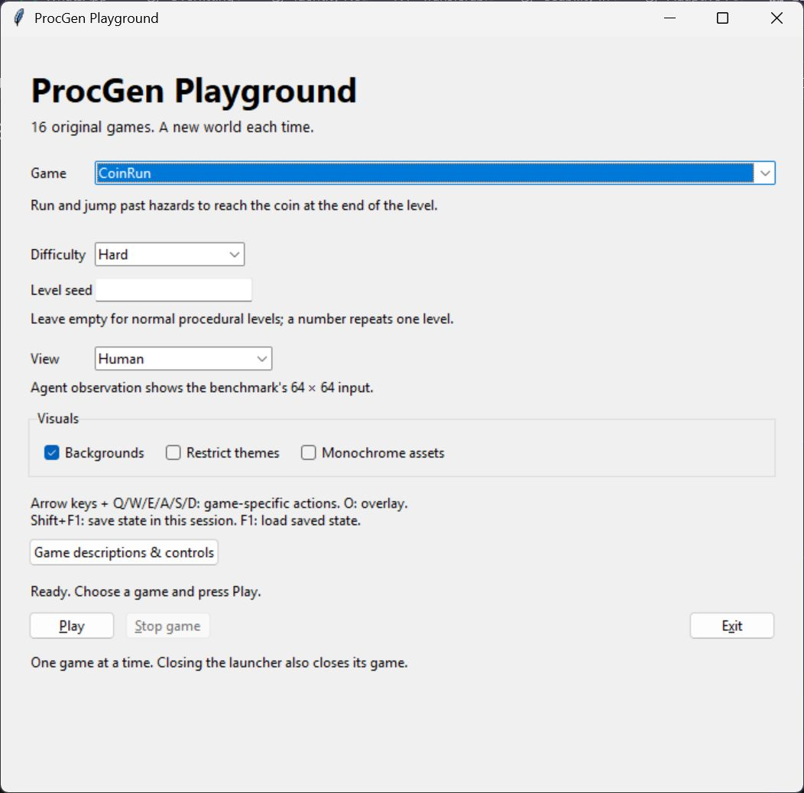

# ProcGen Playground

Play the original 16 ProcGen games through an independent Windows desktop app.
This project is not an official OpenAI product.

[**Download for Windows**](https://github.com/JoBuettner/ProcGen-Playground/releases)
— download the portable ZIP, extract it, and open `ProcGenPlayground.exe`.
Python and an installer are not required.

Includes Qt (LGPLv3) and libquadmath (LGPL-2.1-or-later). Matching source and
rebuild instructions are provided in the accompanying
`ProcGenPlayground-corresponding-sources.zip`. Read `THIRD-PARTY-NOTICES.txt`.
Using the bundled Microsoft runtime components constitutes agreement to their
component-specific terms; those terms preserve all other components' licenses.
Only the portable ZIP is needed to play; the source companion is provided for
license compliance and rebuilding.

Automatic builds from `main` are published as development prereleases.
See [status](docs/STATUS.md) for automated checks and recorded manual coverage.

## Play

1. Extract the entire `ProcGenPlayground-Windows-x64-portable.zip`.
2. Open the extracted `ProcGenPlayground` folder.
3. Double-click `ProcGenPlayground.exe`, choose a game, and press **Play**.
4. Close the game window to return to the launcher and choose another game.

Choose **Easy** or **Hard**, leave the level seed empty for procedural levels
or enter a number to repeat one level, and select **Human** or **Agent observation**
view. Backgrounds, theme restriction, and monochrome assets use upstream options.
The initial defaults are CoinRun, Hard, Human, and standard visuals.

One launcher and one game run at a time. **Stop game** returns to the menu;
**Exit** or closing the launcher also stops its game. Selections stay in the
current launcher session; preferences are not written to the installation folder.
Keyboard: Tab navigates controls; Alt+P plays, Alt+S stops, and Alt+X exits.

You do not need Python, a terminal, or an internet connection to play.
Requirements: Windows 10/11 x64, an AVX-capable processor, and an OpenGL 3.3
graphics driver. Download both source and binary archives from the
[release page](https://github.com/JoBuettner/ProcGen-Playground/releases);
only the portable binary ZIP is needed to play. Keep its `_internal` folder
next to the EXE. Local builds are under `dist/ProcGenPlayground/`; the EXE
under `build/` is an intermediate file and cannot run by itself.

## Controls

ProcGen's original controls are preserved: arrow keys and Q/W/E/A/S/D perform
game-dependent actions. CoinRun uses left/right to move and up to jump.
`O` toggles the upstream information overlay. `Shift+F1` saves the current state
in memory; `F1` reloads it during the same session. The score appears in the
upstream overlay. See the [upstream game descriptions](https://github.com/openai/procgen#environments).

## Troubleshooting

Startup failures show a dialog when possible. Logs are stored per user at
`%LOCALAPPDATA%\ProcGenPlayground\logs\launcher.log` and `game.log`, with bounded rotation.
Extract all files together; do not move the executable away from `_internal`.
The app never downloads dependencies or compiles the engine at runtime.

Report bugs through [GitHub Issues](https://github.com/JoBuettner/ProcGen-Playground/issues).
Include the release tag, Windows version, selected game/options and exact error.
Review logs for personal information before attaching them.

## Development

Use Windows x64 and CPython 3.10. Follow [BUILD.md](docs/BUILD.md) for the pinned
dependencies, tests, and portable build. Current verification is recorded in
[STATUS.md](docs/STATUS.md); the [original implementation plan](PROCGEN_PLAYGROUND_CODEX_PLAN.md)
is retained as historical development context.

The engine, timing, controls, and assets come from unmodified `procgen==0.10.7`.
The wrapper is MIT licensed; upstream code, assets, and dependencies have their
own terms. Read [attributions](docs/ATTRIBUTION.md) before redistribution.
The [redistribution record](docs/licensing/REDISTRIBUTION.md) describes the
included notices, source companion and replacement procedures. Redistributors
must keep the matching source companion available alongside each portable ZIP.
